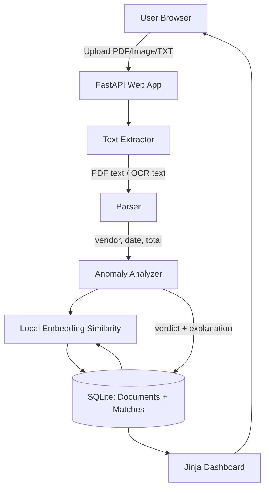

# Edge Alert

A tiny local-first FastAPI app that watches uploaded receipts, invoices, or bills and flags unusual charges using simple rules plus local text-similarity matching against past documents.

## What works in this MVP

- Upload a PDF, image, or text file from the browser.
- Extract text locally:
  - PDFs: embedded text via `pypdf`.
  - Images: OCR via `pytesseract` if the Tesseract system binary is installed.
  - TXT: direct text read, useful for quick local trials.
- Parse likely vendor, date, and total.
- Compare against saved past documents with local hashed embeddings / cosine similarity.
- Store documents and matches in SQLite.
- Return a clear verdict: `normal`, `review`, or `unusual`, with a short explanation.

## Architecture



## Quick start

```bash
cd brain-edge-alert
python -m venv .venv
source .venv/bin/activate  # Windows: .venv\Scripts\activate
pip install -r requirements.txt
cp .env.example .env
python seed.py
uvicorn app.main:app --reload
```

Open <http://127.0.0.1:8000>.

## Optional image OCR setup

PDF text extraction works with Python dependencies only when the PDF contains selectable text. For image uploads or scanned PDFs, install the Tesseract system binary:

- macOS: `brew install tesseract`
- Ubuntu/Debian: `sudo apt-get install tesseract-ocr`
- Windows: install from the official Tesseract installer and ensure `tesseract.exe` is on PATH.

If Tesseract is not installed, image uploads will still be accepted, but the app will explain that OCR text could not be extracted.

## Environment variables

See `.env.example`.

| Variable | Default | Description |
| --- | --- | --- |
| `DATABASE_URL` | `sqlite:///./edge_alert.db` | SQLAlchemy database URL. SQLite is recommended for local-first use. |
| `UPLOAD_DIR` | `uploads` | Local folder where uploaded files are saved. |
| `ANOMALY_HIGH_TOTAL_MULTIPLIER` | `1.6` | If a vendor's new total is this many times above past average, flag it. |
| `ANOMALY_NEW_VENDOR_THRESHOLD` | `75` | New vendors above this amount are marked for review. |
| `SIMILARITY_MATCH_THRESHOLD` | `0.35` | Minimum cosine similarity to save a related-document match. |

## Usage tips

1. Run `python seed.py` to add several realistic past documents.
2. Upload a bill similar to an existing vendor with a normal total: it should be marked `normal`.
3. Upload a much higher bill from the same vendor: it should be marked `unusual`.
4. Upload a high-value bill from a brand-new vendor: it should be marked `review`.

## Smoke test

After starting the server, you can also run:

```bash
python smoke_test.py
```

It uploads a sample text receipt through the HTTP API and prints the verdict.
